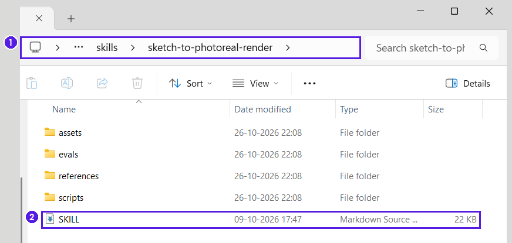
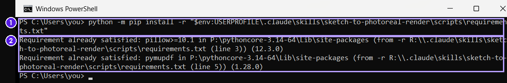
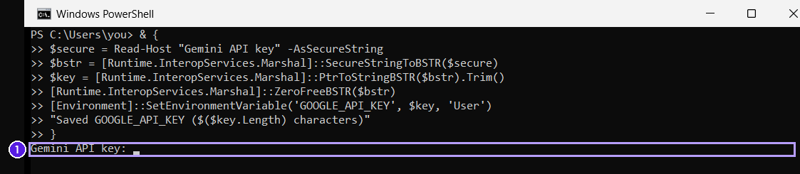
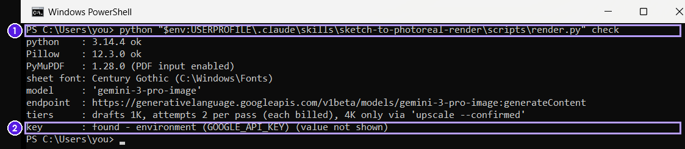
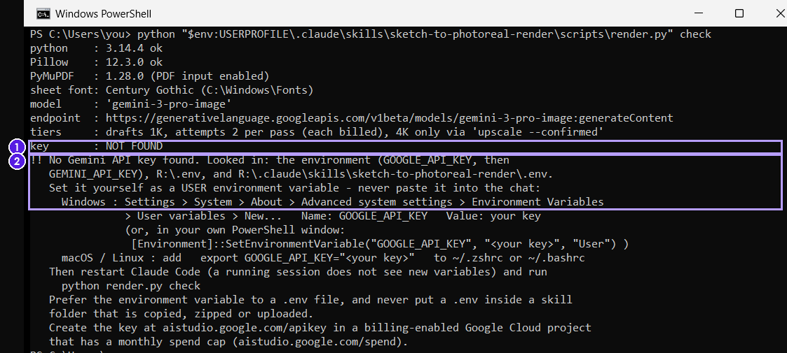
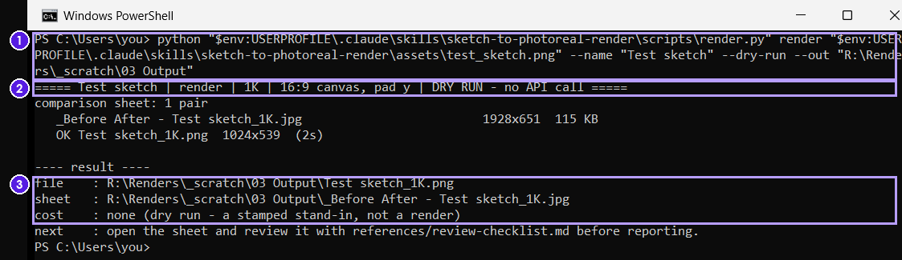
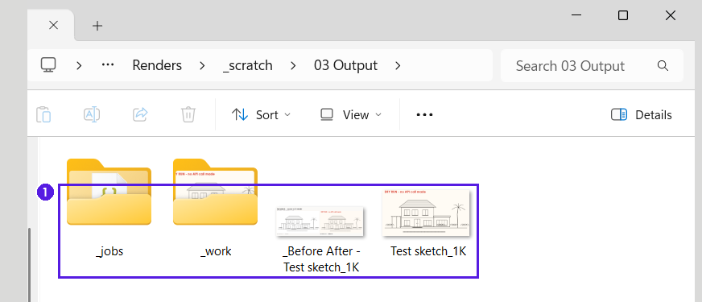
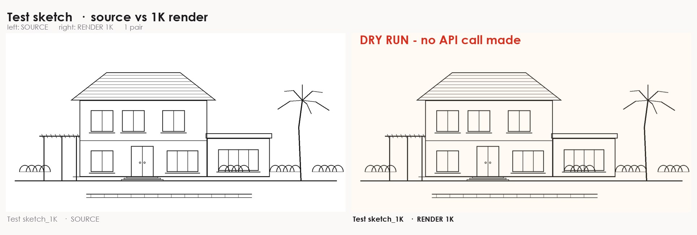
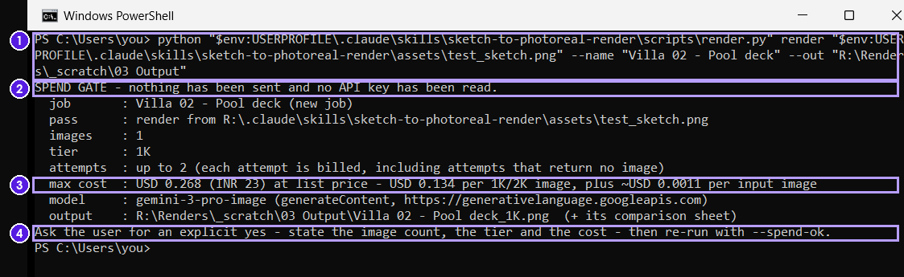

# Setup guide: sketch-to-photoreal-render

Step by step, from a fresh Claude Code to your first render. Steps 1 to 8 cost nothing. Nothing
is billed until Step 9, and only after you say yes to a cost Claude shows you.

The screenshots are real captures of the skill on Windows. On them, `R:\.claude\skills` stands for
`C:\Users\<your name>\.claude\skills`, `R:\Renders` for `C:\Renders`, `P:\` for the folder where
Python is installed, and `C:\Users\you>` for your own user name. A placeholder stood in for the key;
no real key appears and nothing was sent to Google.

## Steps at a glance

| # | What you do | Where | Cost |
|---|---|---|---|
| 1 | Open Claude Code | Claude desktop app or terminal | none |
| 2 | Download the skill | GitHub | none |
| 3 | Copy it into your skills folder | File Explorer | none |
| 4 | Install the Python packages | PowerShell | none |
| 5 | Check that Claude Code sees the skill | Claude Code | none |
| 6 | Create the Google key and a spend cap | Google AI Studio | none yet |
| 7 | Save the key on your computer | PowerShell | none |
| 8 | Setup check and a free dry run | Claude Code | none |
| 9 | First live render | Claude Code | up to USD 0.268 per pass, after your yes |
| 10 | Revise, patch, and 4K for one approved image | Claude Code | revision up to USD 0.268; 4K up to USD 0.48, each after your yes |

## Before you start

| You need | Detail |
|---|---|
| Claude Code | On a Claude plan that includes it. Use the desktop app's Code tab or the `claude` CLI. |
| A Google AI Studio key | In a Google project with billing switched on. Image models have no free tier. |
| Python 3.9 or later | `python --version` must print a version. If it opens the Microsoft Store instead, install Python from python.org with **Add python.exe to PATH** ticked. |
| Century Gothic | `GOTHIC.TTF` and `GOTHICB.TTF`, for the sheet labels (on Windows it comes with Microsoft Office). On macOS or Linux the script also finds URW Gothic. The setup check tells you what it found. |

> **Where this runs:** Claude Code on your own computer. The skill cannot render in claude.ai chat
> or in the Claude API skills container: neither can reach Google, and neither can hold the key
> safely. There it says so, and offers only the written brief and a prompt-only preview.

## Step 1: Open Claude Code

1. Install the Claude desktop app from claude.ai/download, sign in, and open the **Code** tab. (Or
   run `claude` in a terminal: every step below works the same way.)
2. Choose your renders folder (for example `C:\Renders`) as the working folder.
3. When Claude Code asks to run a `render.py` command, allow it one command at a time. A command
   with `--spend-ok`, or `upscale --confirmed`, spends money: allow it only after you have said yes
   to the cost, and never choose an always-allow option for it.

## Step 2: Download the skill

On this repository's page choose **Code > Download ZIP** and unzip it, or clone the repository.
Install the skill as it is: do not ask Claude to rebuild it from scratch. A rebuilt script drifts
in the padding, the crop-back and the spending gates, and that is where the quality is lost.

## Step 3: Copy it into your skills folder

1. Open File Explorer, click the address bar, type `%USERPROFILE%\.claude` and press Enter. If there
   is no folder named `skills`, create one. (macOS / Linux: `~/.claude/skills`.)
2. In the downloaded files, find the folder `sketch-to-photoreal-render`: the one that holds this
   guide and `SKILL.md`. Copy that folder into `skills`.
3. Open `skills\sketch-to-photoreal-render`. `SKILL.md` must be directly inside, next to the
   folders `assets`, `evals`, `references` and `scripts`. The guide, the README and the `docs`
   folder come along too; they do no harm.



*The correct result: the path ends in skills > sketch-to-photoreal-render (box 1) and SKILL sits
directly inside (box 2). Windows may hide the .md.*

> **The most common mistake** is an extra folder level, such as
> `skills\sketch-to-photoreal-render\sketch-to-photoreal-render\SKILL.md`. Claude Code will not list
> the skill. Delete `skills\sketch-to-photoreal-render` and copy the folder again, straight into
> `skills`.

## Step 4: Install the Python packages

1. Open PowerShell from the Start menu.
2. Type `python --version` and press Enter. It must print a version number.
3. Paste this command and press Enter:

```
python -m pip install -r "$env:USERPROFILE\.claude\skills\sketch-to-photoreal-render\scripts\requirements.txt"
```

On macOS or Linux: `python3 -m pip install -r ~/.claude/skills/sketch-to-photoreal-render/scripts/requirements.txt`



*The command (box 1) and a good result (box 2): Pillow and PyMuPDF are already present or get
installed. Nothing else is installed.*

PyMuPDF is only needed for PDF input, and it is AGPL-licensed. Without it, export page 1 of a PDF
as a PNG.

## Step 5: Check that Claude Code sees the skill

1. Quit Claude Code completely and open it again, so it scans the skills folder (or type
   `/reload-skills`). If the Claude icon stays by the clock, right-click it and choose **Quit**.
2. Type `/skills` and press Enter. The list must show `sketch-to-photoreal-render`. If it does not,
   go back to Step 3.

## Step 6: Create the Google key and a monthly spend cap

Do this in your browser, signed in to the Google account that owns the billing project.

**Set the monthly cap first**

1. Open aistudio.google.com/spend, pick the billing-enabled project and set a monthly cap you are
   comfortable with. Only a project editor, owner or admin can set one.
2. If the project has no billing yet, set it up in AI Studio first. Renders fail until billing is
   on.
3. Google updates spend with a delay of roughly ten minutes, so the cap is a backstop, not a live
   meter.

**Create the key**

1. Open aistudio.google.com/apikey and choose **Create API key** in the same project.
2. Keep the page open: you copy the key in Step 7.

> **Never paste the key into Claude.** The skill never asks for it, never accepts it in chat and
> refuses to print it. If a key is ever pasted into a chat, treat it as exposed: delete it in AI
> Studio and create a new one.

## Step 7: Save the key on your computer, outside Claude

1. Open a new PowerShell window yourself. Do not use a terminal inside Claude.
2. Paste the whole block below, braces included. The braces make PowerShell read all of it before
   it asks for the key. If Windows asks about pasting several lines, choose **Paste anyway**.
3. If `Gemini API key:` already shows after the paste, just paste the key (it appears as asterisks)
   and press Enter. If it does not show yet, press Enter once to run the block, then paste the key.
   The last line confirms how many characters were saved, for example
   `Saved GOOGLE_API_KEY (39 characters)`. If it says 0 characters, run the block again.
4. Quit Claude Code completely and start it again. A window that was already open does not see the
   new variable.

```powershell
& {
$secure = Read-Host "Gemini API key" -AsSecureString
$bstr = [Runtime.InteropServices.Marshal]::SecureStringToBSTR($secure)
$key = [Runtime.InteropServices.Marshal]::PtrToStringBSTR($bstr).Trim()
[Runtime.InteropServices.Marshal]::ZeroFreeBSTR($bstr)
[Environment]::SetEnvironmentVariable('GOOGLE_API_KEY', $key, 'User')
"Saved GOOGLE_API_KEY ($($key.Length) characters)"
}
```



*The block pasted and PowerShell waiting for the key (box 1). The key appears as asterisks.*

On macOS or Linux, add `export GOOGLE_API_KEY="<your key>"` to `~/.zshrc` or `~/.bashrc` in your
own editor, then open a new terminal.

The key now lives in a user environment variable: out of the shell history and out of every file the
skill ships. Prefer this to a `.env` file, and never put a `.env` in the skill folder.

## Step 8: Setup check and a free dry run

Paste this into Claude Code as one message. Nothing is billed.

```
/sketch-to-photoreal-render
Setup check. Run render.py check, then render.py check --online (the free models.get call).
Then do a dry run on the bundled assets/test_sketch.png with --out "C:\Renders\_scratch\03 Output",
open the comparison sheet and tell me what it shows. Nothing billed.
```

**What the setup check should show.** The screenshots show the same command run directly in
PowerShell, which is what Claude runs for you. In the good case the key line reads
`found - environment (GOOGLE_API_KEY) (value not shown)`: the source is named, the value never is.



*A good check: the command (box 1) and the key found in the environment (box 2).*



*If the key is not seen: key NOT FOUND (box 1) and the skill's own instructions (box 2). Follow
Step 7, then restart Claude Code.*

`check --online` is a free metadata call that confirms the model answers for your key. It does not
prove that billing is on: only the first live render does.

**The dry run** runs the whole pipeline except the call to Google: it pads the drawing, builds a
stand-in, crops it back and writes the comparison sheet. The output folder must be outside the skill
folder.



*The command (box 1), the DRY RUN banner (box 2) and the result with cost none (box 3).*



*What lands in the output folder (box 1): the `_jobs` and `_work` folders, the comparison sheet and
the 1K picture.*



*A good result: the test sketch on the left and a stamped "DRY RUN - no API call made" stand-in on
the right, at the same proportions.*

## Step 9: Your first live render (it asks before spending)

Give Claude the full path of the drawing (a pasted image has no path). In File Explorer, select the
file and press Ctrl+Shift+C to copy its path. Replace the example path and names with your own:

```
/sketch-to-photoreal-render
Drawing: C:\Renders\Villa 02\02 Input\pool-deck.png
View name: Villa 02 - Pool deck
Materials: terracotta Mangalore roof tiles, white lime plaster, teak windows
Lighting: late-afternoon sun from the left, soft shadows
Environment: coconut palms behind, clear sky, lawn to the front
Other: pergola stays open; no furniture
```

1. **Claude prepares, for free.** It tells you the drawing will go to Google's Gemini API, opens it,
   writes the element inventory and checks the prompt without sending it.
2. **Claude quotes the cost and waits.** This is the spending gate. The script makes no billed call
   without the flag `--spend-ok`, and Claude adds it only after your yes. Without it, nothing is
   sent and no key is read.



*The spending gate, run directly in PowerShell: nothing sent and no key read (box 2), the maximum
cost (box 3) and the instruction to ask you (box 4). In Claude Code it appears as a message.*

3. **You say yes to the stated cost.** Claude renders (one attempt can take up to 15 minutes), opens
   the comparison sheet and checks it for redesign, re-frame, invented text, added objects, swapped
   materials and a re-solved roof.
4. **Claude reports** the render, the sheet, a verdict (match, minor or major) with the issues, and
   the cost so far.

> **What counts as approval:** say yes only to a cost Claude has shown you. "Looks good, do them all
> in 4K" is refused, and "make it sharper" is not approval for 4K. Approval is for one image at a
> time.

## Step 10: Revise, patch and approve one image for 4K

Every revision stays at 1K and needs its own yes. Its sheet pairs the image being revised with the
new one.

| Ask for | Use it for | Cost shown first |
|---|---|---|
| A revision | One change to the current render. One change per pass works best. | 1 image, 1K, up to USD 0.268 |
| A patch | One local area (a door, a wrong plant). Only that box is re-rendered; every pixel outside it stays identical. | 1 image, 1K, up to USD 0.268 |
| 4K approval | One approved image, named by its exact file name. It must be the latest pass of that view. The 1K file is never overwritten. | 1 image, 4K, up to USD 0.48 |

Example requests:

```
Revise "Villa 02 - Pool deck_1K.png" at 1K. Change only: the pool water calmer and paler aqua.
Keep everything else identical.
```

```
Patch "Villa 02 - Pool deck_1K_rev02.png", entrance door area only:
the door is solid teak with two vertical bronze pull bars. Keep everything else identical.
```

```
I approve "Villa 02 - Pool deck_1K_rev03.png" for 4K. Upscale only that image.
```

**Files in the output folder**

| File | What it is |
|---|---|
| `<view>_1K.png` | The first render |
| `<view>_1K_rev02.png`, `_rev03` ... | Each revision or patch |
| `<view>_1K_rev03_4K.png` | The 4K of the approved image; the 1K file is never touched |
| `_Before After - <file stem>.jpg` | The comparison sheet for that pass |
| `_work/` | The padded feed, the raw frame and the exact prompt sent |
| `_jobs/<view>.json` | The ledger: every pass, attempt and list-price cost |

## Troubleshooting

| What you see | Fix |
|---|---|
| `/skills` does not list the skill | `SKILL.md` must be at `...\.claude\skills\sketch-to-photoreal-render\SKILL.md`, with no extra folder level. Run `/reload-skills` or restart Claude Code. |
| `python` opens the Microsoft Store | Install Python from python.org with **Add python.exe to PATH** ticked, then open a new PowerShell window. |
| `key : NOT FOUND` after you set the key | Claude Code, or the terminal it runs in, was already open. Quit it and start again. |
| `HTTP 400 ... API key not valid` | The key is wrong or was deleted. Create a new one in AI Studio and set it again yourself (Step 7). |
| `HTTP 401` or `403` | 401: the key is invalid or expired. 403: the key lacks permission, for example an older key not restricted to the Gemini API. Create a new key and set it again. |
| `HTTP 400 FAILED_PRECONDITION`, or `HTTP 429` naming a free-tier quota with limit 0 | Billing is not on for the key's project, and image models have no free tier. Enable billing in AI Studio; waiting will not fix it. This is the most likely first failure on a new Google project. |
| `HTTP 404` | The model id is not served to this key. Ask Claude to run `render.py check --online`. |
| `SpendCapReached` | The project hit its monthly cap. Nothing more renders until you raise it at aistudio.google.com/spend or the month rolls over. |

The error table in `SKILL.md` covers the rest, and Claude reads it.
